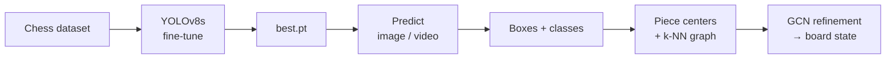
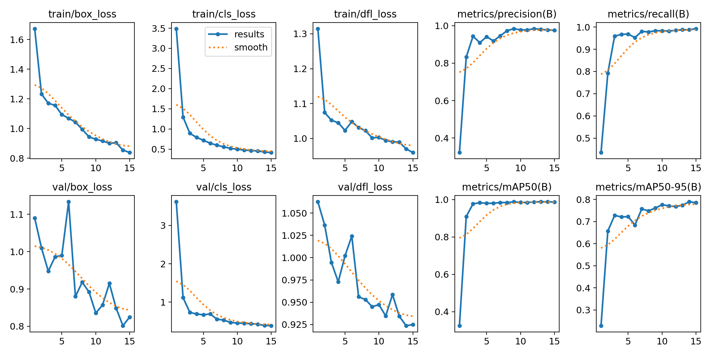
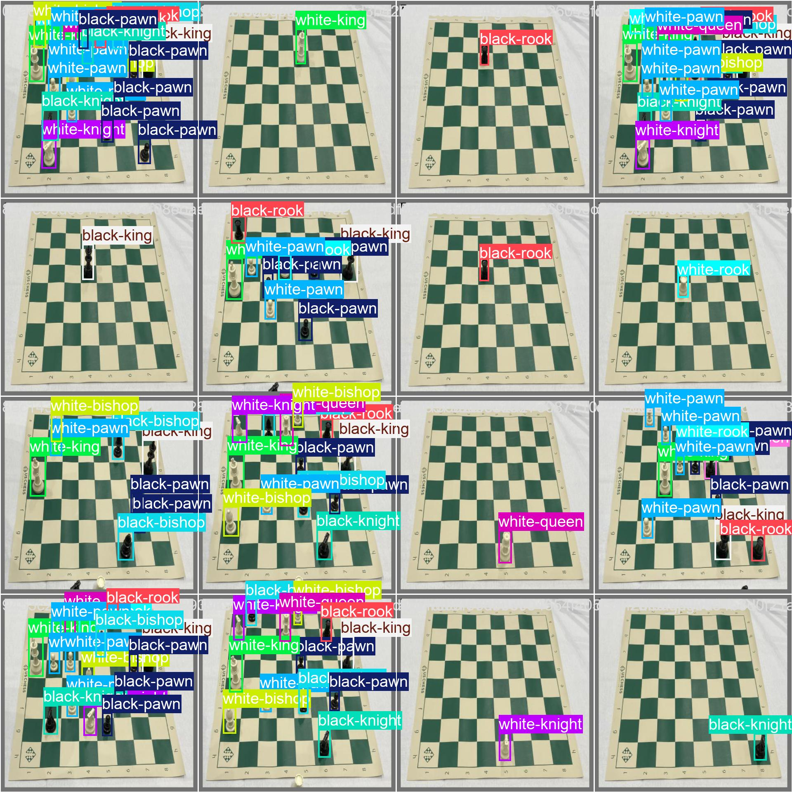
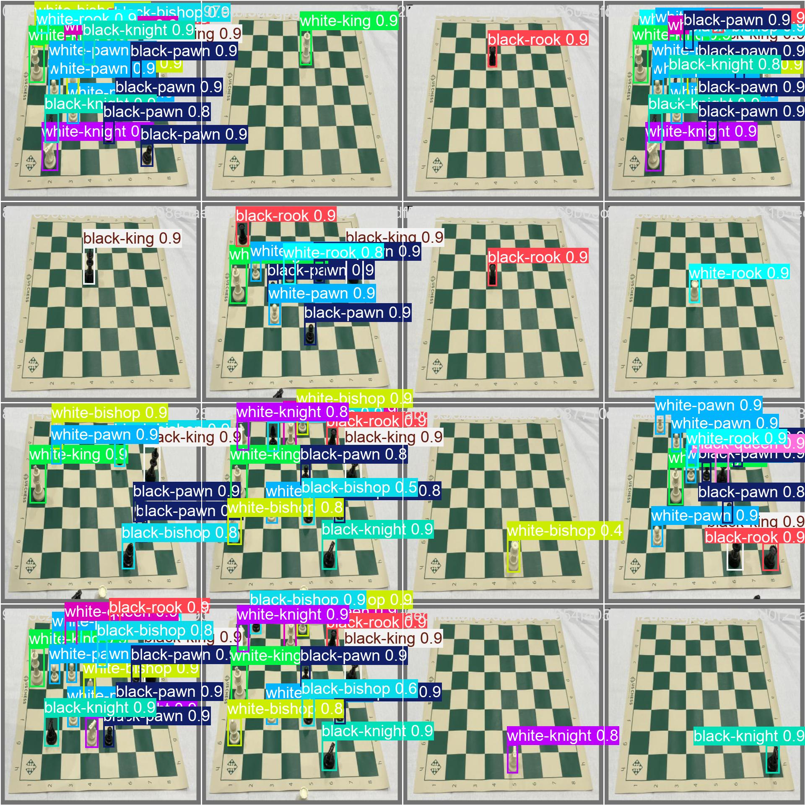

# Vision-Based Chess Game Reconstruction Using DL

Fine-tuned **YOLOv8s** chess-piece detector with an experimental **GCN**
refinement stage over detected piece positions.

- [train_predict.ipynb](train_predict.ipynb) — train YOLOv8s + run image/video inference
- [check_with_gnn.ipynb](check_with_gnn.ipynb) — build graph over detections, train 2-layer GCN

---

## Code Flow

---

## Model Architecture

**Stage 1 — YOLOv8s detector**
`Input 640×640 → CSPDarknet backbone → PAN-FPN neck → decoupled anchor-free head → (x1,y1,x2,y2,conf,cls)`
Classes: 12 chess piece types. Fine-tuned from `yolov8s.pt` for 15 epochs, batch 32, lr0 = 1e-4, imgsz = 640.

**Stage 2 — GCN refinement**
`centers → k-NN(k=3) graph → GCNConv(2→32) → ReLU → GCNConv(32→NUM_CLASSES) → softmax`
Adam (lr = 0.01), CrossEntropyLoss, 100 epochs. Proof-of-concept scaffold in the notebook.

---

## Results

Final epoch (15), from [results.csv](runs/detect/train21/results.csv):

| Precision | Recall | mAP@0.5 | mAP@0.5:0.95 |
|:---------:|:------:|:-------:|:------------:|
| **0.975** | **0.993** | **0.986** | **0.785** |

---

## Inference Results

| Ground truth | Model prediction |
|:--:|:--:|
|  |  |

Video inference saved to [runs/detect/train22/example.mp4](runs/detect/train22/example.mp4) — stable per-frame boxes at `conf=0.6`, no false positives on empty squares.

---

## Conclusion

- YOLOv8s transfers well: mAP@0.5 jumps from 0.33 → 0.98 by epoch 3, settles at **0.986 / 0.993 recall** by epoch 15.
- Remaining errors are mostly tight-box localization and bishop/pawn confusion at steep angles.
- GCN stage works end-to-end on toy inputs; next step is to feed real YOLO detections and evaluate full board (FEN-match) accuracy.
